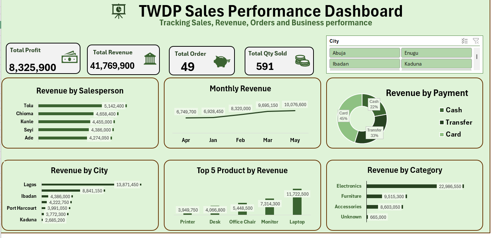

# TWDP Sales Performance Dashboard

An interactive sales performance dashboard built to monitor revenue, profit, order volume, quantity sold, and business performance across salespeople, cities, products, categories, payment methods, and months.

The project uses a 2026 sales dataset containing 49 order records from January to May. The dashboard provides a management-level view of sales performance and includes a City slicer for focused analysis.

## Table of Contents

- [Dashboard Preview](#dashboard-preview)
- [Introduction](#introduction)
- [Data Overview and Dataset Structure](#data-overview-and-dataset-structure)
- [Data Cleaning and Preparation](#data-cleaning-and-preparation)
- [Dashboard Analysis](#dashboard-analysis)
- [Conclusion](#conclusion)
- [Recommendations](#recommendations)
- [Assumptions and Limitations](#assumptions-and-limitations)
- [How to Use the Dashboard](#how-to-use-the-dashboard)
- [Tools and Repository Structure](#tools-and-repository-structure)
- [Author](#author)

## Dashboard Preview



## Introduction

Businesses need a clear understanding of what drives revenue, where sales are strongest, which products perform well, and how salespeople contribute to overall results. Without this information, management may struggle to identify profitable products, monitor regional performance, and make informed sales decisions.

This project analyses the TWDP sales dataset and presents the results in an interactive dashboard. It is designed to answer practical business questions, including:

- How much revenue and profit did the business generate?
- How many orders were recorded, and how many units were sold?
- Which salespeople generated the highest revenue?
- Which cities contributed most to revenue?
- Which products and categories performed best?
- How did revenue change from January to May?
- What proportion of revenue came from each payment method?

## Data Overview and Dataset Structure

The dataset contains **49 sales records** covering January to May 2026. Each row represents a sales order record.

| Column | Description |
|---|---|
| Order Date | Date the order was placed |
| Ship Date | Date the order was shipped |
| Salesperson | Person responsible for the sale |
| Town | Town or area associated with the order |
| City | City associated with the order |
| Product | Product sold |
| Category | Product category |
| Quantity Sold | Number of units sold |
| Unit Price | Selling price per unit |
| Discount % | Discount rate applied to the order |
| Unit Cost | Cost per unit |
| Customer Type | Retail or Corporate |
| Payment Method | Cash, Transfer or Card |
| Gross Sales | Quantity sold multiplied by unit price |
| Discount Amount | Discount value deducted from gross sales |
| Revenue | Gross sales less discount amount |
| Total Cost | Quantity sold multiplied by unit cost |
| Profit | Revenue less total cost |
| Order Value Category | Classification of the order value |
| Profit Status | Classification of the profit level |

### Dataset summary

| Metric | Value |
|---|---:|
| Reporting period | January–May 2026 |
| Sales records / orders | 49 |
| Total quantity sold | 591 |
| Total revenue | 41,769,900 |
| Total profit as recorded | 8,325,900 |

*Currency is not specified in the supplied dataset, so monetary values are shown without a currency symbol.*

## Data Cleaning and Preparation

The supplied dataset contains some values that should be reviewed before using the results for formal business decisions. The following data-quality observations were identified from the source records:

| Data-quality observation | Recommended treatment / consideration |
|---|---|
| Salesperson recorded as `Unknown` | Confirm the responsible salesperson if the source record can be checked; otherwise retain as Unknown |
| Product spelling `Hea Dset` | Standardise to `Headset` after validating the intended product |
| Town spelling variants such as `Gar Ki` and `Wud Il` | Validate and standardise town names |
| Category recorded as `Unknown` | Confirm the correct product category; do not guess |
| Unit Price recorded as 0 in two records | Verify the selling price; these records currently contribute zero revenue |
| Unit Cost is blank in one record | Confirm the cost; the recorded total cost is zero and the recorded profit may therefore be overstated |
| Payment Method recorded as `Unknown` | Confirm the payment method or retain Unknown |
| Ship Date occurs before Order Date in some records | Validate the dates before using shipping-time analysis |

The dashboard figures reflect the supplied calculated fields. The observations above are documented as data-quality limitations rather than silently changing the source data.

## Dashboard Analysis

This section explains the main dashboard visuals and the business information they provide.

### 1. Headline KPIs

The dashboard displays four key performance indicators:

- **Total Profit:** 8,325,900
- **Total Revenue:** 41,769,900
- **Total Orders:** 49
- **Total Quantity Sold:** 591

These KPIs provide a quick overview of sales activity and financial performance during the reporting period.

### 2. Revenue by Salesperson

The chart compares revenue generated by each salesperson. The leading five shown on the dashboard are:

| Salesperson | Revenue |
|---|---:|
| Tolu | 5,142,400 |
| Chioma | 4,658,800 |
| Kunle | 4,455,000 |
| Seyi | 4,386,000 |
| Ade | 4,274,050 |

Tolu recorded the highest revenue among the salespeople displayed. Management can use this comparison to recognise strong performance and investigate practices that may be transferable to other salespeople.

### 3. Monthly Revenue

The monthly revenue chart shows the following values:

| Month | Revenue |
|---|---:|
| January | 6,928,450 |
| February | 8,320,000 |
| March | 9,695,150 |
| April | 6,749,700 |
| May | 10,076,600 |

May recorded the highest monthly revenue, while April recorded the lowest. Revenue increased from January through March, declined in April, and reached its highest point in May.

### 4. Revenue by Payment Method

The payment-method chart shows the share of revenue by payment channel:

- Card: 45%
- Transfer: 33%
- Cash: 22%

Card payments contributed the largest share of revenue in the dashboard. This can help management understand customer payment preferences and plan payment-channel support.

### 5. Revenue by City

The dashboard compares revenue across the cities represented in the dataset. The leading cities shown are:

| City | Revenue |
|---|---:|
| Lagos | 13,871,450 |
| Abuja | 8,841,150 |
| Ibadan | 4,386,000 |
| Kano | 4,222,750 |
| Port Harcourt | 3,991,050 |
| Enugu | 3,772,300 |
| Kaduna | 2,685,200 |

Lagos generated the highest revenue among the cities shown. This may help management assess regional demand, sales coverage, and opportunities for expansion.

### 6. Top 5 Products by Revenue

The dashboard highlights the five products with the highest revenue:

| Product | Revenue |
|---|---:|
| Laptop | 17,722,500 |
| Monitor | 7,314,300 |
| Office Chair | 5,448,500 |
| Desk | 4,066,800 |
| Printer | 3,949,750 |

Laptop generated the highest revenue by a substantial margin. Management may consider its sales contribution when planning inventory and product promotions, while also monitoring profitability and stock requirements.

### 7. Revenue by Category

The category chart reports the following revenue:

| Category | Revenue |
|---|---:|
| Electronics | 22,986,550 |
| Furniture | 9,515,300 |
| Accessories | 8,603,050 |
| Unknown | 665,000 |

Electronics contributed the largest share of revenue. The Unknown category should be investigated because incomplete classification reduces the reliability of category-level reporting.

### 8. City Slicer

The City slicer allows users to filter the dashboard by selected cities. This makes it possible to focus on a particular market and compare its salespeople, products, categories, and revenue performance with the overall business.

## Conclusion

The TWDP Sales Performance Dashboard provides a consolidated view of sales performance across 49 records from January to May 2026.

The dashboard reports total revenue of 41,769,900, total profit of 8,325,900, 49 orders, and 591 units sold. Lagos is the leading city by revenue, Tolu is the leading salesperson shown, Electronics is the highest-revenue category, and Laptop is the top product by revenue. May recorded the highest monthly revenue.

The dashboard also highlights data-quality issues that should be resolved before the figures are used for high-stakes financial or operational decisions.

## Recommendations

1. **Protect the leading product category.** Monitor Electronics inventory and demand because it contributes the largest category revenue.
2. **Review Laptop sales and stock planning.** Laptop is the leading product by revenue; management should monitor stock availability, margins, and customer demand.
3. **Investigate the April revenue decline.** Review order volume, product availability, discounts, and salesperson activity to understand why April was the lowest month.
4. **Learn from high-performing salespeople.** Review the sales approaches and customer segments associated with the strongest revenue results.
5. **Review regional sales coverage.** Lagos leads city revenue. Compare customer demand and sales coverage in lower-revenue cities before making expansion decisions.
6. **Maintain payment-channel options.** Card is the largest revenue channel, but Transfer and Cash also contribute meaningful shares.
7. **Improve data quality.** Validate zero prices, the missing unit cost, unknown values, spelling inconsistencies, and ship dates earlier than order dates.
8. **Review profit calculations.** Confirm the missing unit cost before relying on the recorded profit total, because a zero total cost can overstate profit.

## Assumptions and Limitations

- The analysis covers the 49 records supplied, with order dates from January to May 2026.
- The currency is not identified in the supplied data.
- Dashboard totals and chart values are reported as displayed.
- Two records have a Unit Price of zero, resulting in zero revenue in the supplied calculations.
- One record has a missing Unit Cost and a recorded Total Cost of zero. Its recorded profit should be treated with caution.
- One salesperson, one product category, and one payment method contain Unknown values.
- Spelling inconsistencies in town and product names may split categories unless standardised.
- Some Ship Dates precede their Order Dates and require validation.
- The dataset is limited to the supplied period and records; the findings should not automatically be generalised to other periods.

## How to Use the Dashboard

- **Quick look:** View the dashboard screenshot in the `images/` folder.
- **Interactive analysis:** Open the Excel workbook in the `excel/` folder and use the City slicer to filter the visuals.
- **Dataset:** Find the supplied source data in the `data/` folder.

## Tools and Repository Structure

**Tools:** Microsoft Excel, Excel PivotTables, PivotCharts, and Slicers.  
*Update this list if additional tools or methods were used in the workbook.*

```text
TWDP-Sales-Performance-Dashboard/
│
├── README.md
├── excel/
│   └── TWDP_Sales_Performance_Dashboard.xlsx
├── data/
│   └── TWDP_Sales_Dataset.xlsx
├── images/
│   └── TWDP_Sales_Performance_Dashboard.png
└── report/
    └── TWDP_Sales_Performance_Report.pdf
```

## Author

**Hassan Rosheedat Temitayo**  

Data Analyst | Python | Excel | SQL | Power BI

[E-mail](rosheedathassan7@gmail.com) | [LinkedIn](www.linkedin.com/in/hassan-rosheedat-570a6340a)
